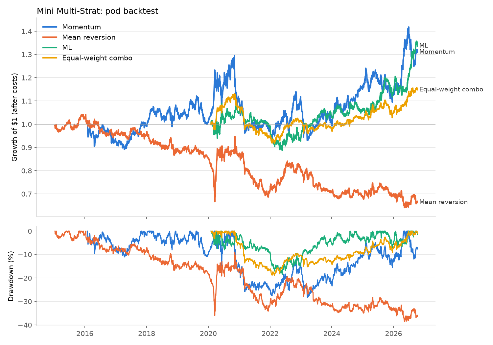
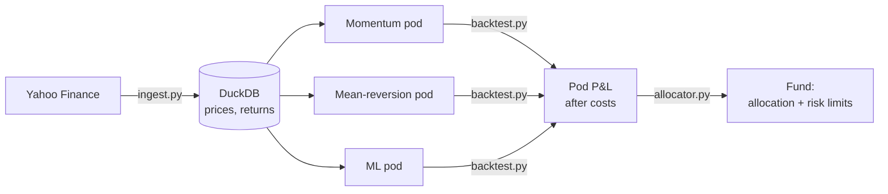

# Mini Multi-Strat

A small-scale simulator of a **multi-manager hedge fund**, built in Python.

Several independent strategy "pods" each run their own market-neutral stock book. A central allocator decides how much capital each pod gets, enforces risk limits (including pod stop-outs), and nets all the pods' positions into one fund book. Everything is backtested on ~10 years of daily data for 52 large US stocks, with trading costs and strict protection against look-ahead bias.



## How it works



| Step | File | What it does |
|---|---|---|
| 1 | `src/universe.py` | 52 liquid US stocks across all sectors, plus 8 ETFs used as benchmarks |
| 2 | `src/ingest.py` | Downloads adjusted daily prices since 2015 into a DuckDB database and runs data-quality checks |
| 3 | `src/pods.py` | The three strategies; each turns prices into daily target weights |
| 4 | `src/allocator.py` | Runs the pods together as one fund, with capital allocation and risk limits |
| 5 | `src/backtest.py` | Simulates each pod with next-day execution and trading costs, and reports performance |

## The pods

Every pod is **dollar-neutral long/short**: it buys its 10 favourite stocks and shorts its 10 least favourite, 50% of capital on each side. It aims to profit from the difference between stocks, not from the market rising.

| Pod | Idea | Signal | Rebalance |
|---|---|---|---|
| **Momentum** | Winners keep winning | Return from 12 months ago to 1 month ago ("12-1") | Monthly |
| **Mean reversion** | Short-term overreactions snap back | Minus the past 5-day return | Weekly |
| **ML** | Let a model learn how to combine signals | LightGBM prediction of next-month relative return from 7 ranked features (1-week, 1-month and 3-month returns, 12-1 momentum, 1- and 3-month volatility, distance from 52-week high) | Monthly |

The ML pod is trained **walk-forward**. At the start of each year a new model is trained only on data whose outcome was already known, with a 22-day purge gap so no training label overlaps the prediction period. It needs 3 years of history before it trades, so it starts in 2020.

## The allocator and risk limits

The allocator plays the role of a multi-manager fund's central risk team. It is built around **risk budgets**: the pods naturally swing by different amounts, so a single loss limit would mean "a normal bad month" for a volatile pod and "something is broken" for a calm one. Like a real multi-manager fund, every pod is first resized to the same risk, and every rule is then set in units of that risk:

- **Risk budgets.** Each month, every pod is scaled to 10% annual volatility based on its last 6 months.
- **Allocation.** Every live pod gets an equal share of the fund's risk, with no pod above 50%.
- **Fund volatility target.** The whole fund is scaled to 8% annual volatility using the covariance between pods. Total gross exposure is capped at 3x capital.
- **Pod drawdown limits**, in multiples of the 10% budget. At 0.75x the budget (−7.5% from peak) a pod's capital is halved, and it gets full capital back once it recovers to within 0.25x (−2.5%). At 1.5x (−15%) it is stopped out for 3 months, then restarted. These multiples were set once on principle and not tuned to the backtest, which would only fit the past.
- **Single-stock limit.** The fund's combined position in any one stock is capped at 10% of capital.
- **Netting.** All pods' positions are summed into one book before trading, so offsetting trades between pods cancel out. The fund reports the cost this saves.

The fund is also run with the drawdown limits switched off, so the report shows exactly what the limits add.

## Results so far

Pod backtest, January 2015 to October 2026, after 5 bps trading costs:

| | Momentum | Mean reversion | ML | Equal-weight mix |
|---|---|---|---|---|
| Live from | Feb 2016 | Jan 2015 | Feb 2020 | Feb 2020 |
| Annual return | 2.6% | −3.4% | 4.4% | 2.1% |
| Annual volatility | 12.0% | 10.7% | 9.1% | 6.4% |
| Sharpe ratio | 0.27 | −0.27 | 0.52 | 0.36 |
| Max drawdown | −28.2% | −38.5% | −18.6% | −19.0% |
| Beta to SPY | 0.01 | 0.12 | 0.16 | 0.09 |
| Turnover per year | 6x | 81x | 16x | 34x |
| Cost drag per year | 0.3% | 4.1% | 0.8% | 1.7% |

Correlation of daily returns: momentum vs ML −0.21, momentum vs mean reversion −0.05, mean reversion vs ML 0.05.

**What this shows**

- **The ML pod is the strongest** and diversifies momentum (negative correlation), so it adds something the hand-built signals don't.
- **Mean reversion has a small edge that trading costs destroy.** It is roughly flat before costs, but turning over 81x its capital a year costs about 4%.
- **Combining pods works as intended.** The equal-weight mix runs at about half the volatility of the individual pods.
- **Risk limits have to be calibrated to each pod's volatility.** A first version used a flat −10% stop-out for every pod. Pods swinging 9–12% a year hit it 17 times, cutting them near their lows and missing the recoveries, which made the fund worse than no limits at all. The allocator now uses risk budgets instead, so a stop-out means a pod is doing unusually badly for itself, not just having a normal bad month.

## Avoiding look-ahead bias

A backtest is only useful if it never uses information it couldn't have had. This project enforces that in three ways:

1. **Next-day execution.** Weights decided at day *t*'s close are only held from *t+1*.
2. **Walk-forward ML.** Models are trained only on purged past data, as described above.
3. **A scramble test.** Randomly scrambling every price after a cut-off date leaves all earlier pod weights, fund positions and fund returns unchanged.

## Limitations

- **Survivorship bias.** The universe is today's large companies, picked with hindsight, which flatters results, especially for momentum.
- **Simple costs.** A flat 5 bps per dollar traded. No market impact, borrow fees on shorts, or interest on cash.
- **Dollar-neutral, not beta-neutral.** Mean reversion and ML keep a small positive market beta (0.12–0.16).
- **Small universe.** 52 stocks and 10 names per side means results are noisy.
- **Weights held at target.** Between rebalances, positions are assumed to stay at their target weights rather than drifting with prices.

## Next steps

- Cut the mean-reversion pod's trading costs (trade less often, or only when the signal is strong)
- Make pods beta-neutral, not just dollar-neutral
- Add a fourth, non-price pod (for example an earnings or value signal)

## Run it

Easiest: on this page click **Code → Codespaces → Create codespace on main**, then in the terminal:

```bash
pip install -r requirements.txt
python src/ingest.py      # download prices into data/market.duckdb
python src/pods.py        # preview each pod's current positions
python src/backtest.py    # backtest each pod -> reports/
python src/allocator.py   # run the full fund -> reports/
```

To run locally instead, use Python 3.11+ in a virtual environment and run the same commands.

**Built with** Python, pandas, NumPy, DuckDB, LightGBM, matplotlib and yfinance.
